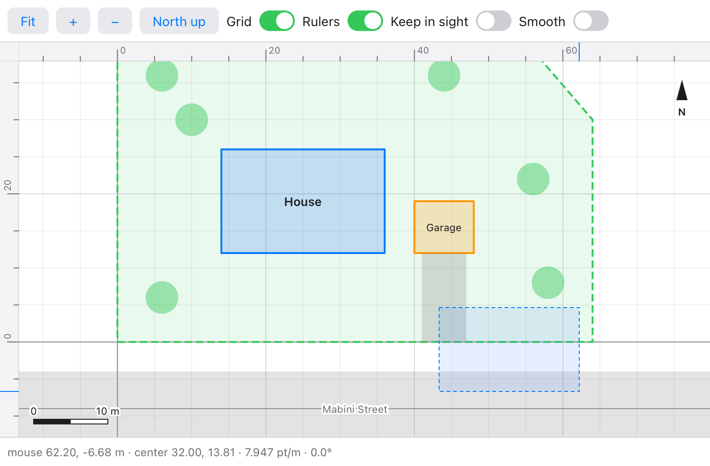

# viewport

Pan, zoom, rotate and fit for [Tessel](https://tessel-lang.syncster.dev)
`Canvas` views: drawings, plans, maps, plots and pictures. A `Viewport`
turns world coordinates (metres, pixels, degrees) into points on the
canvas and back, and handles the mouse and keys the way drawing programs
do. It also draws a grid that suits the zoom, rulers, a scale bar and a
zoom box, and moves smoothly when it fits or zooms by a step.



```tessel
import viewport

app Plan(width: 700, height: 480) {
    state vp = viewport.Viewport(content: viewport.box(0, 0, 60, 40))

    Canvas { g in
        viewport.drawGrid(g, vp)
        g.save()
        vp.apply(g)                     // draw in metres from here
        g.strokeRect(x: 10, y: 10, width: 20, height: 12, color: .blue, lineWidth: 2)
        g.restore()
        viewport.drawZoomBox(g, vp)
        viewport.drawScaleBar(g, vp, x: 16, y: g.height - 14, unit: "m")
    }
    .onResize { w, h in vp.resize(w, h) }
    .onPointer { e in
        let _used = vp.handle(e)
    }
    .onKey { key in
        let _used = vp.handleKey(key)
    }
    .onAppear {
        every(seconds: 1.0 / 60.0) { vp.tick() }    // smooth moves
    }
}
```

The wheel zooms about the mouse, a drag pans, Shift and a drag zooms into a
box, a double click or "0" fits the content, and "+", "−" and the arrows
zoom and pan.

## Using it

Add it to a project (Tessel 0.10 or later):

```sh
tessel add viewport
```

then `import viewport`. (`view` is a word Tessel keeps for itself, so name
your viewport something else, like `vp`.)

## Coordinates

| Field | |
|---|---|
| `width`, `height` | The canvas's size in points. Set them with `resize(w, h)` from `.onResize`. |
| `centerX`, `centerY` | The world point in the middle of the canvas. |
| `scale` | Points per unit of the world: 20 means a metre is drawn 20 points long. |
| `angle` | How far the picture is turned on the screen, counterclockwise, in radians. |
| `yDown` | `false` (the default): world y grows upwards, as in drawings, maps and plots. `true`: downwards, as in pictures and pages. |

| Method | Gives |
|---|---|
| `toScreen(x, y)` | Where a world point shows, as `(sx, sy)` in points from the canvas's top left corner. |
| `toWorld(sx, sy)` | The world point at a point of the canvas, such as an `onPointer` event's `e.x`, `e.y`. |
| `screenX(x, y)`, `screenY(x, y)`, `worldX(sx, sy)`, `worldY(sx, sy)` | One coordinate of those, for use inside expressions. |
| `toScreenPoints(points)` | Many points (`x, y, x, y, …`) on the screen, ready for `g.lines`. |
| `points(length)`, `length(points)` | A world length in points, and back: for a snap distance in metres, say. |
| `visible()` | The world box the canvas shows: for drawing only what's in sight. |
| `onScreen(box)` | The screen box around a world box. |
| `apply(g)` | Sets the canvas's transform so that what follows is drawn in world coordinates. |

You can draw in two ways. Either convert each point with `toScreen`, or
call `apply(g)` between `g.save()` and `g.restore()` and draw in world
units. With `apply`, lines and text keep their size in points. When y grows
upwards, text drawn under `apply` comes out upside down, so put text at
`toScreen` points after `g.restore()`. Pass `angle: -vp.angle` to turn
the text along with the picture.

## Moving

| Method | |
|---|---|
| `pan(dx, dy)` | Moves the picture by screen points, the way a drag does. |
| `zoom(by: f, sx, sy)` | Zooms by `f` about a point of the canvas; the world point there stays there. |
| `zoomCentered(by: f)`, `setScale(s)` | Zooms about the middle. |
| `zoomIn()`, `zoomOut()` | Zooms about the middle by `zoomStep` (1.5). |
| `rotate(by: a, sx, sy)` | Turns about a point of the canvas. |
| `setAngle(a)` | Turns to an angle about the middle. |
| `centerOn(x, y)` | Puts a world point in the middle. |
| `fit(box)`, `fitContent()` | Shows all of a box (or `content`), `margin` points (20) from the edges. |
| `zoomToScreenBox(x1, y1, x2, y2)` | Zooms into a rectangle of the canvas. |
| `show(x, y, scale, angle)` | Goes to a place. |
| `resize(w, h)` | The canvas's new size. The middle stays where it is. The first call fits `content` at once (unless `fitFirst` is false), so the drawing shows whole when the window opens. |

Limits: zooming stops at `minScale` and `maxScale`. Set `content` to the
box around your drawing (`viewport.box(x1, y1, x2, y2)`, or
`viewport.boxAround(points)`). With `keepInSight: true`, panning and
zooming then stop while `sight` points (40) of the content still show on
each side.

### Smooth moves

While `smooth` is true (the default), `fit`, `fitContent`, `zoomIn`,
`zoomOut`, `centerOn`, `show` and the zoom box move over `duration`
seconds (0.25). They speed up at first and slow down at the end. A zoom
keeps the point that stays put fixed the whole way. Start a timer to run
these moves:

```tessel
.onAppear { every(seconds: 1.0 / 60.0) { vp.tick() } }
```

`tick()` takes the move on by a sixtieth of a second, and does nothing when
no move is under way. Moves are timed by ticks, not by the clock, so a
headless test's `wait` runs them too. `finish()` jumps to the end of a
move, and `stop()` leaves the view where it is. `animating` says whether a
move is under way. Zooming with the mouse is never smoothed, because the
view follows the mouse directly.

## The mouse and keys

`handle(e)` does what the mouse does, for `.onPointer`. It returns `true`
if it used the event, and `false` if the event is the app's (a move, or a
left drag when `leftDragPans` is off), so an app with tools of its own
writes:

```tessel
.onPointer { e in
    if !vp.handle(e) {
        myTool(e, vp.toWorld(e.x, e.y))
    }
}
```

| | What it does | Field |
|---|---|---|
| Wheel, two-finger scroll | Zooms about the mouse. With Cmd or Option held, it pans. | `wheel: .pans` swaps the two |
| Pinch | Zooms about the mouse. | |
| Left drag | Pans. | `leftDragPans: false` leaves left drags to the app |
| Middle drag | Pans. | |
| Shift and a left drag | Draws a zoom box (`drawZoomBox(g, vp)` shows it) and zooms into it. | `boxZoom` |
| Right drag | Turns the picture. | `rotates: true` (off by default) |
| Double click | Fits the content. | `doubleClickFits` |

`handleKey(key)` does what keys do, for `.onKey`, and returns `false` for
keys it doesn't use. "+" (or "=") and "−" zoom, "0" fits the content, the
arrows pan by an eighth of the canvas, and "[" and "]" turn by `rotateStep`
(15°) when `rotates` is on.

## Grids, rulers and scale bars

| Function | |
|---|---|
| `drawGrid(g, vp, spacing:, color:, minorColor:, axisColor:)` | Grid lines a round step apart (1, 2 or 5 × 10ⁿ, at least `spacing` points, 100), fainter lines between them, and the axes. It turns with the view. |
| `drawRulers(g, vp, size:, spacing:, color:, background:, mouseX:, mouseY:)` | Rulers along the top and left edges, labelled in world units, with a mark at the mouse. Not drawn while the view is turned. |
| `drawScaleBar(g, vp, x:, y:, maxWidth:, unit:, color:)` | A map's scale bar showing a round length at most `maxWidth` points long (120). With `unit: "m"`, it switches to km and mm when the numbers get large or small. |
| `scaleBar(vp, maxWidth:, unit:)` | That length, its size in points and its label, for drawing your own bar. |
| `drawZoomBox(g, vp, color:)` | The zoom box while it's dragged. |
| `gridStep(vp, spacing:)` | The grid's step: for snapping to the grid. |
| `niceStep(x)` | The smallest round number that is at least `x`. |
| `tickLabel(value, step:)` | A number with as many decimals as the step needs, like `2.5e6` when it's very large or small. |

## Tests

```sh
tessel run tests
TESSEL=tessel sh tests/ui.sh
```

The first checks the library against 1500 random views put through 9587
random pans, zooms, turns, resizes, fits and zoom boxes (33 000 values).
The expected values in `tests/cases.json` come from
`python3 tools/oracle/oracle.py`, which works each view out a different
way, as a 3×3 matrix (it needs numpy). It then checks the rest by hand:
boxes, the mouse and keys, smooth moves, limits, steps and labels. The
second drives the example app headless with the mouse, keys and buttons
(22 checks).

## What's where

| File | |
|---|---|
| `viewport.tsl` | `Viewport`: conversions, moving, the mouse and keys, smooth moves; `Wheel` and `Drag`. |
| `box.tsl` | `Box`, `box` and `boxAround`. |
| `draw.tsl` | Grids, rulers, scale bars, the zoom box, round steps and labels. |
| `examples/main.tsl` | A site plan to try it on: `tessel run examples`. |
| `tests/` | The tests and the oracle's cases. |
| `tools/oracle/oracle.py` | Makes the cases. |

## Licence

MIT: see [LICENSE](LICENSE).
